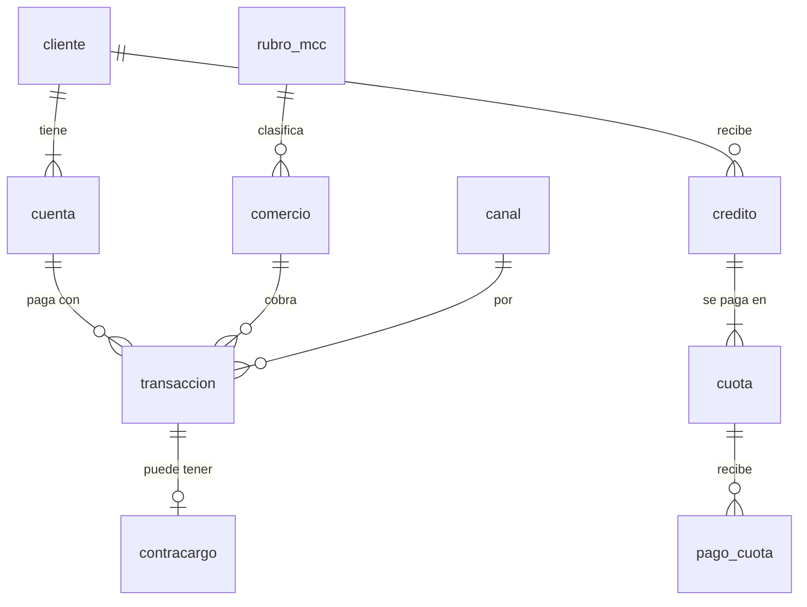

# PayMarket Perú · Análisis de pagos y microcréditos con SQL

> **Los datos de este proyecto son simulados.** PayMarket Perú es una empresa ficticia. Las personas, comercios, RUC, DNI, celulares y correos son inventados y no corresponden a nadie real.

## Qué es este proyecto

Un informe para la gerencia de una fintech de pagos peruana, construido con SQL Server sobre unas 300 mil operaciones de 18 meses (enero 2025 a junio 2026): 20 mil clientes con billetera digital, 600 comercios afiliados y 5 mil microcréditos.

El repositorio incluye el curso con el que lo construí sesión a sesión (`sesiones/`), la base de datos reproducible (`base/`) y el análisis final (`proyecto/`).

## Preguntas de negocio

1. ¿Cómo evolucionan el volumen y la facturación, y qué estacionalidad tiene el negocio?
2. ¿Qué comercios y rubros concentran los ingresos por comisión?
3. ¿Dónde y por qué se rechazan pagos, y cuánto ingreso se pierde?
4. ¿Qué clientes se registran y no usan la billetera? ¿Cómo retiene cada cohorte?
5. ¿Qué comercios muestran un nivel de contracargos anormal?
6. ¿Cómo se comporta la mora de los microcréditos por cosecha y categoría SBS?
7. Si fuera analista de PayMarket: ¿qué haría primero y con qué impacto estimado, bajo supuestos explícitos?

## Modelo de datos

La base se organiza en capas: `stg` (datos crudos, sucios a propósito), `core` (datos limpios), `dw` y `rpt` (modelo de análisis y vistas para Power BI). Diagrama y descripción de cada columna en [base/diccionario_datos.md](base/diccionario_datos.md).



## Stack

- SQL Server 2019 o superior (T-SQL) y SQL Server Management Studio
- PowerShell, `sqlcmd` y `bcp` para la instalación
- Power BI Desktop para el dashboard
- Git y GitHub

## Cómo instalar

Paso a paso en [SETUP.md](SETUP.md). En resumen, desde PowerShell:

```powershell
cd base
.\instalar.ps1
```

## Hallazgos

`[COMPLETAR]` Se completa al final del curso con los resultados de [proyecto/hallazgos.md](proyecto/hallazgos.md): 3 a 5 hallazgos, cada uno con su número, su consulta y una recomendación.

## Dashboard

`[COMPLETAR]` Captura y descripción del tablero de Power BI (carpeta [powerbi/](powerbi/)).

## Cómo está organizado

| Carpeta | Contenido |
|---|---|
| [base/](base/) | Instalador, scripts SQL, datos en CSV y diccionario de datos |
| [sesiones/](sesiones/) | Una carpeta por sesión con `guia.md` y `practica.sql` |
| [guias/](guias/) | [La receta de 5 pasos](guias/receta_5_pasos.md) para resolver cualquier pregunta |
| [proyecto/](proyecto/) | Consultas finales y hallazgos del informe |
| [powerbi/](powerbi/) | Archivo `.pbix` y capturas del dashboard |
| [CURRICULA.md](CURRICULA.md) | Temario y avance |

## Autor

**Parker David Cárdenas Cabanillas**
Estudiante de Ingeniería Industrial (8.º ciclo, UTP). Vengo de almacén, despacho y abastecimiento retail, y hoy me formo en análisis de datos.

Hice este proyecto para practicar SQL con preguntas de negocio reales: limpiar datos sucios, modelar en capas y responder qué decisión conviene tomar. Los datos son simulados.

- LinkedIn: [linkedin.com/in/parkercardenas-data](https://www.linkedin.com/in/parkercardenas-data/)
- Portafolio: [smiledxd.github.io](https://smiledxd.github.io)
- Correo: cardenascabanillaspd@gmail.com

Las guías del curso las armé con apoyo de Claude; las consultas y el análisis son míos.