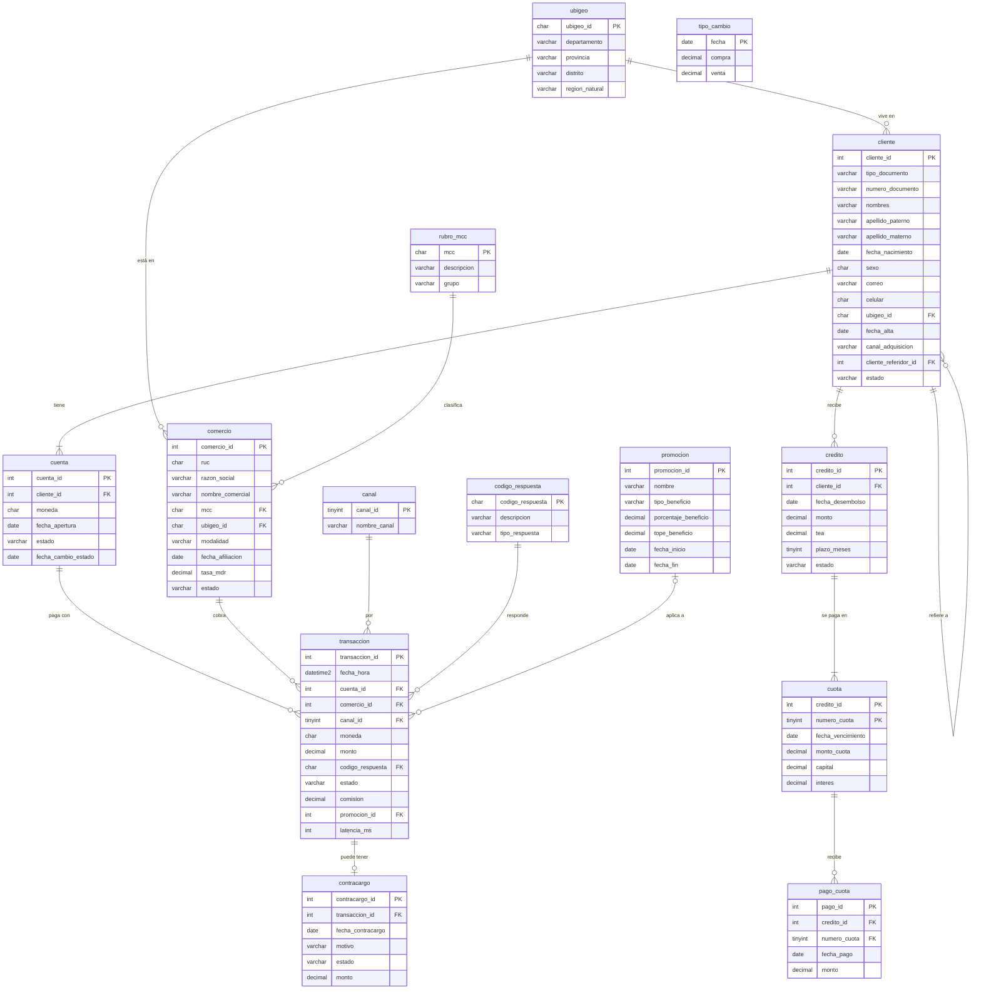

# Diccionario de datos · PayMarket_Analitica

PayMarket Perú es una fintech de pagos **ficticia**. Sus clientes tienen una billetera digital (en soles y, algunos, también en dólares) con la que pagan en comercios afiliados desde la app, la web, un POS físico o un código QR. PayMarket cobra al comercio una comisión por cada pago aprobado y, además, presta microcréditos ("PayMarket Adelanto") a sus clientes.

Todos los datos son simulados: personas, empresas, RUC, DNI, celulares y correos son inventados. Los correos usan dominios que terminan en `.test`, que no existen en internet.

- **Periodo de los datos:** del 1 de enero de 2025 al 30 de junio de 2026. PayMarket empezó a operar en enero de 2025.
- **Fecha de corte:** 30/06/2026. Cuando un ejercicio diga "hoy", se refiere a esa fecha.
- **Moneda:** `PEN` (soles) o `USD` (dólares).

---

## 1. Capas (esquemas)

| Esquema | Qué contiene | Quién lo llena | Equivalente en Databricks/Spark |
|---|---|---|---|
| `stg` | Archivos crudos de sistemas antiguos, **sucios a propósito**, todo como texto | La instalación | bronze |
| `core` | Datos limpios del negocio, con llaves y reglas | La instalación | silver |
| `lab` | Tu zona de pruebas: crea tablas, inserta y actualiza sin miedo | Tú | — |
| `dw` | Modelo estrella para análisis (S18 y S19) | Tú | gold |
| `rpt` | Vistas que alimentan Power BI (S20) | Tú | gold |
| `chk` | Verificadores de los ejercicios | La instalación | — |

Nada de lo que hagas en `stg`, `lab`, `dw` o `rpt` modifica `core`.

---

## 2. Diagrama entidad-relación de `core`

`tipo_cambio` no tiene llave foránea: se une con `transaccion` por la **fecha** de la operación (`CAST(fecha_hora AS DATE) = tipo_cambio.fecha`).

Cómo leer las líneas: `||--o{` significa "uno a muchos": un cliente puede tener muchas cuentas, pero cada cuenta pertenece a un solo cliente. La tabla del lado "muchos" es la que guarda la llave foránea.

---

## 3. Reglas de negocio

1. **Comisión (MDR).** Solo las operaciones **aprobadas** generan comisión: `comision = ROUND(monto × tasa_mdr, 2)`, en la misma moneda de la operación. Las rechazadas tienen comisión 0. Las extornadas también tienen 0, porque al revertirse la operación se devuelve la comisión.
2. **IGV de la comisión.** La comisión se guarda **sin IGV**. El IGV es el 18 % de la comisión.
3. **Estado y código de respuesta.** `Aprobada` y `Extornada` tienen código `00` (la extornada se aprobó y después se revirtió). `Rechazada` tiene un código distinto de `00`, coherente con su `tipo_respuesta`.
4. **Fechas coherentes.** No hay operaciones antes de la fecha de alta del cliente, de la apertura de la cuenta ni de la afiliación del comercio.
5. **Dólares a soles.** Para expresar en soles un monto en dólares, PayMarket usa el tipo de cambio **de compra** del día de la operación: `monto_soles = monto × compra`.
6. **Mora.** La mora no se guarda en ninguna columna: se **calcula** con las cuotas y los pagos. Una cuota está impaga si la suma de sus pagos es menor que `monto_cuota`. Los días de atraso de un crédito son los días entre el vencimiento de su cuota impaga más antigua y la fecha de corte.
7. **Clasificación SBS** (créditos de consumo, según días de atraso): Normal (0 a 8), CPP (9 a 30), Deficiente (31 a 60), Dudoso (61 a 120), Pérdida (más de 120).
8. **Latencia.** `latencia_ms` es lo que tardó el **servidor** en responder, en milisegundos. No mide cuánto tardó la persona.
9. **Cuenta bloqueada o cerrada.** `fecha_cambio_estado` es el día en que la cuenta dejó de estar activa. Una cuenta bloqueada o cerrada no debería aprobar operaciones desde ese día.

---

## 4. Tablas de `core`

### core.ubigeo — distritos (códigos INEI reales)
Una fila = un distrito. 100 distritos de 23 departamentos.

| Columna | Tipo | Descripción |
|---|---|---|
| `ubigeo_id` | CHAR(6) | Código INEI: 2 dígitos de departamento, 2 de provincia y 2 de distrito. Es texto: `070101` (Callao) empieza con cero. **PK** |
| `departamento` | VARCHAR(40) | Departamento. Lima Metropolitana y las provincias de Lima aparecen como `Lima` |
| `provincia` | VARCHAR(40) | Provincia |
| `distrito` | VARCHAR(60) | Distrito |
| `region_natural` | VARCHAR(10) | `Costa`, `Sierra` o `Selva` |

### core.canal — canales de pago
Una fila = un canal.

| Columna | Tipo | Descripción |
|---|---|---|
| `canal_id` | TINYINT | 1 App móvil, 2 Web, 3 POS físico, 4 Pago con QR. **PK** |
| `nombre_canal` | VARCHAR(30) | Nombre del canal. Único |

### core.rubro_mcc — rubros de comercio
Una fila = un código MCC (Merchant Category Code, el estándar de la industria de tarjetas).

| Columna | Tipo | Descripción |
|---|---|---|
| `mcc` | CHAR(4) | Código MCC. Es texto: `0742` (veterinarias) empieza con cero. **PK** |
| `descripcion` | VARCHAR(80) | Qué tipo de negocio es |
| `grupo` | VARCHAR(30) | Agrupación de negocio: Alimentos y bebidas, Restaurantes, Transporte, Salud, Servicios, Retail, Hogar, Entretenimiento, Cuidado personal, Educación, Viajes, Mascotas |

### core.codigo_respuesta — respuestas de autorización
Una fila = un código al estilo ISO 8583.

| Columna | Tipo | Descripción |
|---|---|---|
| `codigo_respuesta` | CHAR(2) | `00` aprobada, `51` fondos insuficientes, `91` emisor no disponible, etc. **PK** |
| `descripcion` | VARCHAR(60) | Qué significa |
| `tipo_respuesta` | VARCHAR(25) | `Aprobada`, `Rechazo del cliente` (fondos, clave, límites), `Rechazo técnico` (fallas de sistema) o `Sospecha de fraude` |

### core.cliente — personas registradas en la billetera
Una fila = un cliente. 20 000 clientes.

| Columna | Tipo | Descripción |
|---|---|---|
| `cliente_id` | INT | Identificador. **PK** |
| `tipo_documento` | VARCHAR(3) | `DNI` o `CE` (carné de extranjería) |
| `numero_documento` | VARCHAR(12) | 8 dígitos para DNI, 9 para CE. Es texto: puede empezar con cero. Único junto con `tipo_documento` |
| `nombres` | VARCHAR(60) | Uno o dos nombres |
| `apellido_paterno` | VARCHAR(40) | |
| `apellido_materno` | VARCHAR(40) | **Puede ser NULL** (personas con un solo apellido registrado) |
| `fecha_nacimiento` | DATE | **Puede ser NULL** (no se registró) |
| `sexo` | CHAR(1) | `F` o `M` |
| `correo` | VARCHAR(100) | **Puede ser NULL**. Único cuando existe |
| `celular` | CHAR(9) | Empieza con 9. **Puede ser NULL** |
| `ubigeo_id` | CHAR(6) | Distrito donde vive. **FK** → `ubigeo` |
| `fecha_alta` | DATE | Día en que se registró |
| `canal_adquisicion` | VARCHAR(20) | Cómo llegó: `Orgánico`, `Campaña digital` o `Referido` |
| `cliente_referidor_id` | INT | Cliente que lo invitó. Solo tiene valor si llegó como `Referido`; si no, es NULL. **FK** → `cliente` (la tabla se apunta a sí misma) |
| `estado` | VARCHAR(10) | `Activo`, `Bloqueado` o `Cerrado` |

### core.cuenta — billeteras
Una fila = una billetera. Cada cliente tiene una en soles y algunos, además, una en dólares.

| Columna | Tipo | Descripción |
|---|---|---|
| `cuenta_id` | INT | Identificador. **PK** |
| `cliente_id` | INT | Dueño. **FK** → `cliente`. Único junto con `moneda` |
| `moneda` | CHAR(3) | `PEN` o `USD` |
| `fecha_apertura` | DATE | Día en que se abrió |
| `estado` | VARCHAR(10) | `Activa`, `Bloqueada` o `Cerrada` |
| `fecha_cambio_estado` | DATE | Día en que dejó de estar activa. NULL si sigue activa |

### core.comercio — comercios afiliados
Una fila = un comercio. 600 comercios.

| Columna | Tipo | Descripción |
|---|---|---|
| `comercio_id` | INT | Identificador. **PK** |
| `ruc` | CHAR(11) | RUC ficticio con dígito verificador válido. Empieza con `20` (empresa) o `10` (persona natural con negocio). Único |
| `razon_social` | VARCHAR(120) | Nombre legal |
| `nombre_comercial` | VARCHAR(80) | Nombre que ve el público. Único |
| `mcc` | CHAR(4) | Rubro. **FK** → `rubro_mcc` |
| `ubigeo_id` | CHAR(6) | Distrito donde está registrado. **FK** → `ubigeo` |
| `modalidad` | VARCHAR(10) | `Presencial` u `Online` |
| `fecha_afiliacion` | DATE | Día en que se afilió a PayMarket |
| `tasa_mdr` | DECIMAL(6,4) | Comisión pactada, como fracción: `0.0350` = 3,50 %. Puede ser 0 (programas promocionales) |
| `estado` | VARCHAR(12) | `Activo` o `Suspendido` |

### core.promocion — campañas
Una fila = una campaña.

| Columna | Tipo | Descripción |
|---|---|---|
| `promocion_id` | INT | Identificador. **PK** |
| `nombre` | VARCHAR(60) | Nombre de la campaña. Único |
| `tipo_beneficio` | VARCHAR(10) | `Cashback` o `Descuento` |
| `porcentaje_beneficio` | DECIMAL(5,2) | Porcentaje del beneficio: `15.00` = 15 % |
| `tope_beneficio` | DECIMAL(10,2) | Beneficio máximo por operación, en soles |
| `fecha_inicio` | DATE | Primer día de vigencia |
| `fecha_fin` | DATE | Último día de vigencia (incluido) |

### core.tipo_cambio — tipo de cambio diario (soles por dólar)
Una fila = un día del periodo, incluidos fines de semana (repiten el valor del viernes).

| Columna | Tipo | Descripción |
|---|---|---|
| `fecha` | DATE | **PK** |
| `compra` | DECIMAL(6,3) | Tipo de cambio de compra. Es el que se usa para pasar dólares a soles |
| `venta` | DECIMAL(6,3) | Tipo de cambio de venta |

### core.transaccion — pagos
Una fila = un intento de pago (aprobado o no). Unas 300 000 filas.

| Columna | Tipo | Descripción |
|---|---|---|
| `transaccion_id` | INT | Identificador. **PK** |
| `fecha_hora` | DATETIME2(0) | Fecha y hora del pago (tiene hora: para un día completo usa un rango) |
| `cuenta_id` | INT | Billetera con la que se pagó. **FK** → `cuenta` |
| `comercio_id` | INT | Comercio que cobró. **FK** → `comercio` |
| `canal_id` | TINYINT | Canal. **FK** → `canal` |
| `moneda` | CHAR(3) | Moneda de la operación (la misma de la cuenta) |
| `monto` | DECIMAL(12,2) | Monto de la operación, en su moneda |
| `codigo_respuesta` | CHAR(2) | Respuesta de autorización. **FK** → `codigo_respuesta` |
| `estado` | VARCHAR(10) | `Aprobada`, `Rechazada` o `Extornada` |
| `comision` | DECIMAL(12,2) | Comisión cobrada al comercio, sin IGV, en la moneda de la operación |
| `promocion_id` | INT | Campaña aplicada. NULL si no hubo. **FK** → `promocion` |
| `latencia_ms` | INT | Tiempo de respuesta del servidor, en milisegundos |

### core.contracargo — disputas de clientes
Una fila = un contracargo (el cliente desconoce o reclama un pago aprobado y pide la devolución).

| Columna | Tipo | Descripción |
|---|---|---|
| `contracargo_id` | INT | Identificador. **PK** |
| `transaccion_id` | INT | Operación reclamada. **FK** → `transaccion`. Única (una operación tiene como máximo un contracargo) |
| `fecha_contracargo` | DATE | Día del reclamo |
| `motivo` | VARCHAR(60) | `No reconoce la compra`, `Producto o servicio no recibido`, `Producto defectuoso o distinto al ofrecido`, `Cobro duplicado` o `Fraude con tarjeta` |
| `estado` | VARCHAR(25) | `En proceso`, `A favor del cliente` o `A favor del comercio` |
| `monto` | DECIMAL(12,2) | Monto reclamado, en la moneda de la operación |

### core.credito — microcréditos "PayMarket Adelanto"
Una fila = un crédito desembolsado. El programa empezó en mayo de 2025.

| Columna | Tipo | Descripción |
|---|---|---|
| `credito_id` | INT | Identificador. **PK** |
| `cliente_id` | INT | Cliente. **FK** → `cliente` |
| `fecha_desembolso` | DATE | Día en que se entregó el dinero. El mes de desembolso es la "cosecha" |
| `monto` | DECIMAL(10,2) | Monto prestado, en soles |
| `tea` | DECIMAL(6,4) | Tasa efectiva anual, como fracción: `0.6500` = 65 % |
| `plazo_meses` | TINYINT | 3, 6, 9 o 12 cuotas mensuales |
| `estado` | VARCHAR(10) | `Vigente` (tiene saldo pendiente) o `Cancelado` (pagado por completo) |

### core.cuota — cronograma de cada crédito
Una fila = una cuota. Cuotas fijas (método francés).

| Columna | Tipo | Descripción |
|---|---|---|
| `credito_id` | INT | **PK** (junto con `numero_cuota`). **FK** → `credito` |
| `numero_cuota` | TINYINT | 1, 2, 3… **PK** |
| `fecha_vencimiento` | DATE | La cuota N vence N meses calendario después del desembolso |
| `monto_cuota` | DECIMAL(10,2) | Lo que se debe pagar: `capital + interes` |
| `capital` | DECIMAL(10,2) | Parte que devuelve el préstamo |
| `interes` | DECIMAL(10,2) | Parte que es interés |

### core.pago_cuota — pagos recibidos
Una fila = un pago. Una cuota puede recibir varios pagos (pagos parciales) o ninguno.

| Columna | Tipo | Descripción |
|---|---|---|
| `pago_id` | INT | Identificador. **PK** |
| `credito_id` | INT | **FK** → `cuota` (junto con `numero_cuota`) |
| `numero_cuota` | TINYINT | Cuota que se está pagando |
| `fecha_pago` | DATE | Día del pago |
| `monto` | DECIMAL(10,2) | Monto pagado |

---

## 5. Tablas de `stg` (sucias a propósito)

Todo es texto (`VARCHAR`) y no hay llaves: así llegan los archivos. Representan información que ya existe limpia en `core`, así que al terminar de limpiarlas podrás **cuadrar** tus resultados contra `core`. Los problemas concretos los descubrirás tú en S15.

### stg.clientes_legado
Exportación del sistema de registro antiguo, con los clientes registrados entre enero y junio de 2025. Una fila debería ser un cliente, pero no siempre lo es.

| Columna | Qué debería contener |
|---|---|
| `id_legado` | Número de registro del sistema antiguo |
| `tipo_doc` | Tipo de documento |
| `nro_doc` | Número de documento |
| `nombres`, `apellidos` | Nombres y apellidos (los dos apellidos juntos) |
| `fecha_nac` | Fecha de nacimiento |
| `sexo` | Sexo |
| `email` | Correo |
| `telefono` | Celular |
| `ubigeo` | Código de distrito |
| `fecha_registro` | Fecha de alta |
| `canal_origen` | Canal de adquisición |

### stg.liquidacion_pos
Líneas de los archivos diarios de liquidación que PayMarket envía a los comercios por las operaciones aprobadas en POS físico entre abril y junio de 2026. Cada archivo liquida las operaciones del día anterior.

| Columna | Qué debería contener |
|---|---|
| `archivo` | Nombre del archivo recibido |
| `fecha_proceso` | Día en que se procesó el archivo |
| `ruc_comercio` | RUC del comercio |
| `nro_operacion` | Número de operación (corresponde a `transaccion_id`) |
| `fecha_operacion`, `hora_operacion` | Cuándo se hizo el pago |
| `moneda` | Moneda |
| `monto_bruto` | Monto de la operación |
| `comision`, `igv_comision` | Comisión e IGV descontados al comercio |
| `monto_neto` | Lo que recibe el comercio: bruto − comisión − IGV |

---

## 6. Esquema `chk`

Lo usan los archivos `practica.sql`. No necesitas abrirlo.

| Objeto | Para qué |
|---|---|
| `chk.sXX_eN`, `chk.sXX_reto` | Verifica tu `#respuesta` para ese ejercicio |
| `chk.ver_progreso` | Muestra qué ejercicios superaste: `EXEC chk.ver_progreso;` o `EXEC chk.ver_progreso 'S02';` |
| `chk.huella_datos` | Conteo y huella de cada tabla, para comprobar que tu instalación es idéntica a la original |
| `chk.ejercicio`, `chk.ejercicio_columna` | Lo esperado de cada ejercicio, guardado **solo como hashes** |
| `chk.intento` | Tu historial de intentos |
